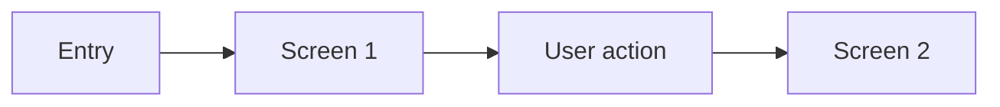

# {Flow name}

- Source: [Mobbin flow URL]({url})
- App: Apple Notes iOS
- Entry surface: {entry}
- Screen count: {count}
- Capture status: pending / captured / reviewed

## Flow chart

## Screens

### 1. {Screen name}

- Visible state:
- User action:
- Transition:

## Observations

- Interaction pattern:
- Feedback or confirmation:
- Edge case:

## BMad handoff notes

- Experience implication:
- Design implication:
- Open question:

