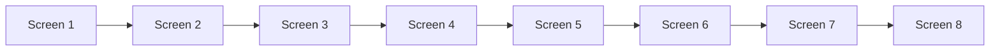
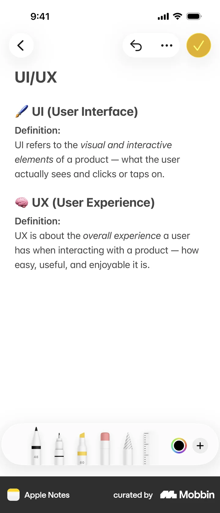
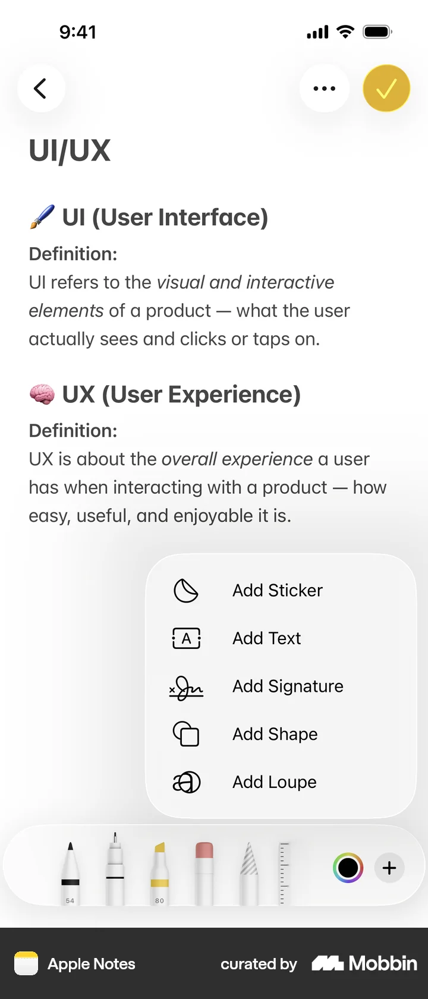
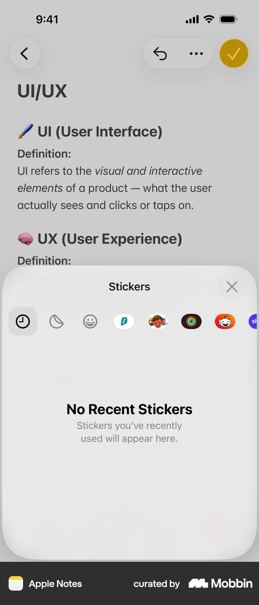
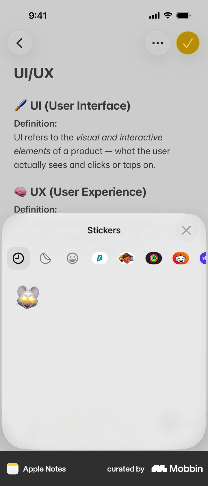
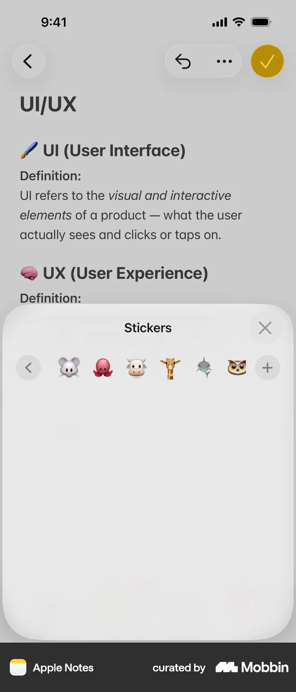
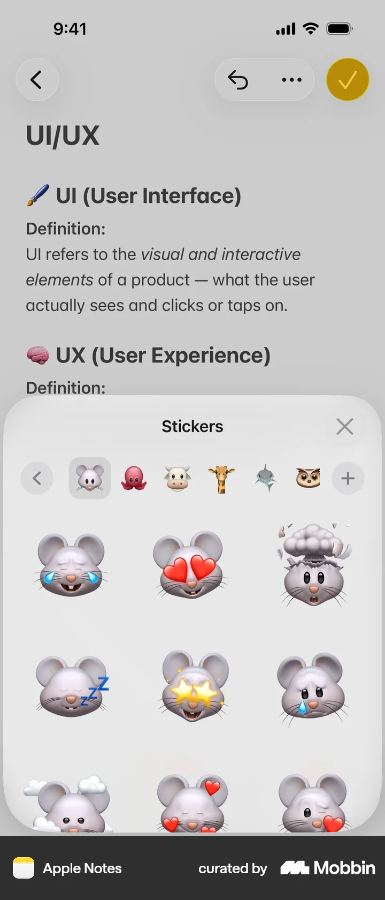
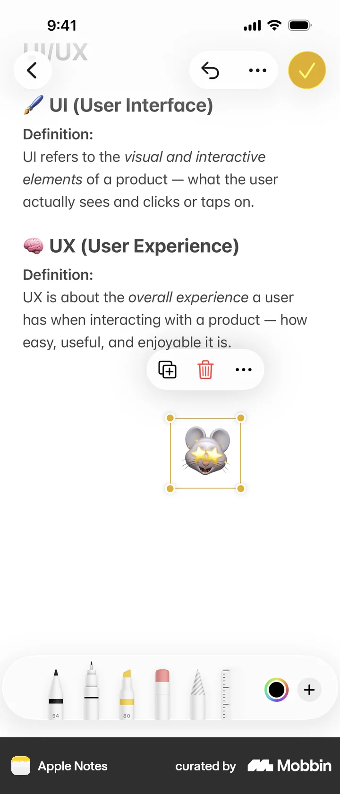
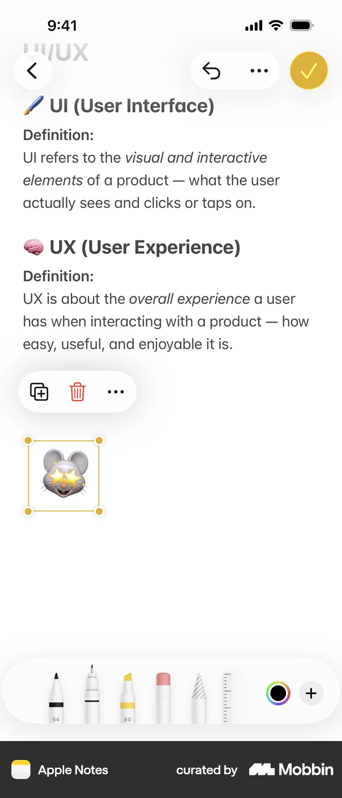

# Adding a sticker

- App: Apple Notes iOS
- Capture status: verified
- Source: [Mobbin detail flow](https://mobbin.com/flows/65cd95f0-c0c6-495a-a1d5-1df4bd8b2b23)
- Verified screens: 8

## Flow chart

## Verified evidence

The screenshots below are downloaded from the Mobbin detail page for this exact flow.

### Screen 1

### Screen 2

### Screen 3

### Screen 4

### Screen 5

### Screen 6

### Screen 7

### Screen 8

## BMad handoff notes

- Implement the interaction sequence in the Mermaid order.
- Treat each screenshot as the visual reference for its corresponding state.
