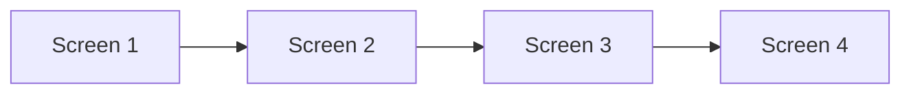
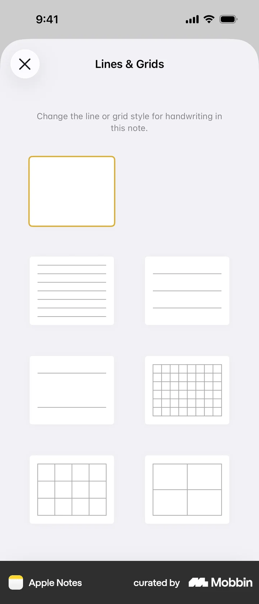
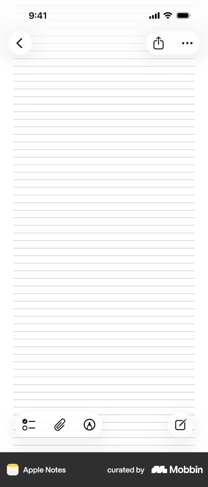

# Adding lines & grids

- App: Apple Notes iOS
- Capture status: verified
- Source: [Mobbin detail flow](https://mobbin.com/flows/b5fefc19-32a4-49ac-b159-1a58fd796609)
- Verified screens: 4

## Flow chart

## Verified evidence

### Screen 1

### Screen 2

### Screen 3

### Screen 4

## BMad handoff notes

- Implement the interaction sequence in Mermaid order.
- Treat each screenshot as the visual reference for its state.
