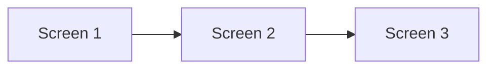
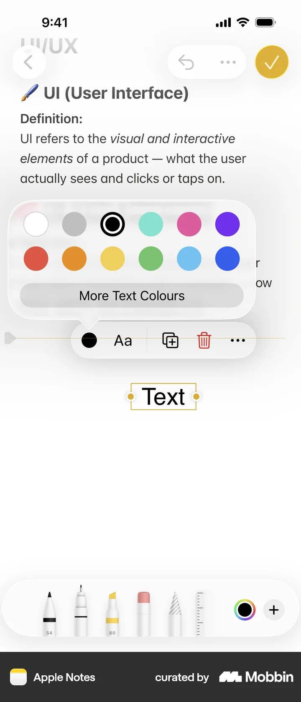
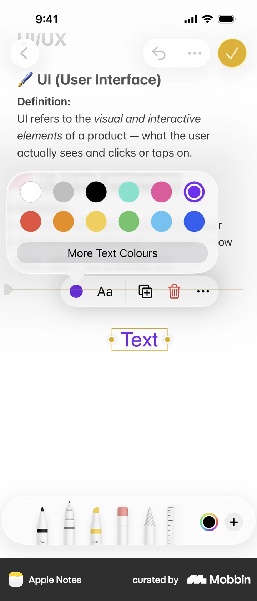

# Changing text color

- App: Apple Notes iOS
- Capture status: verified
- Source: [Mobbin detail flow](https://mobbin.com/flows/5fa24d03-03a3-4cc6-bc0f-29a765504f1b)
- Verified screens: 3

## Flow chart

## Verified evidence

The screenshots below are downloaded from the Mobbin detail page for this exact flow.

### Screen 1

### Screen 2

### Screen 3

## BMad handoff notes

- Implement the interaction sequence in the Mermaid order.
- Treat each screenshot as the visual reference for its corresponding state.
