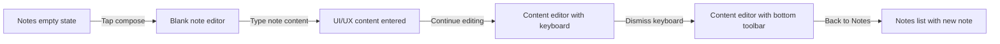
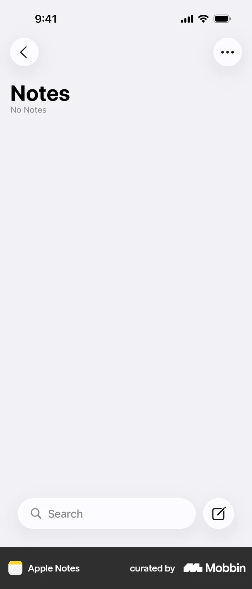
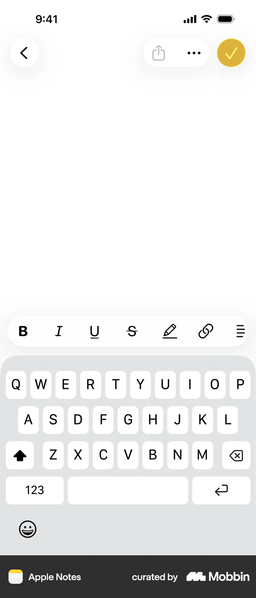
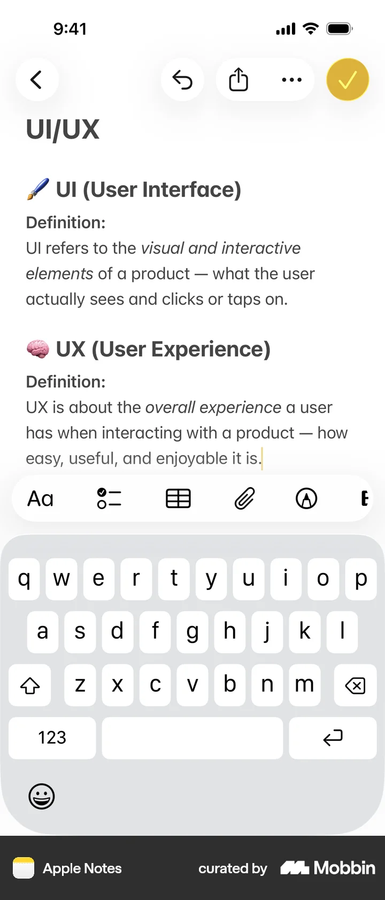
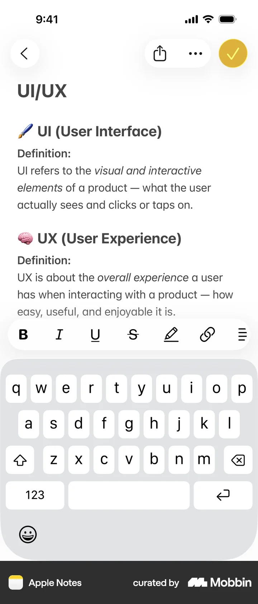
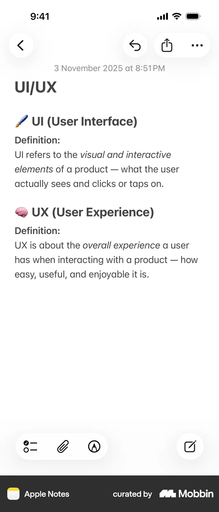

# Creating a note

- Source: [Mobbin detail flow](https://mobbin.com/flows/243b2ee1-b668-4d16-a4af-70fabe323188)
- App: Apple Notes iOS
- Device: iOS 393×852
- Screen count: 6
- Capture status: verified

## Flow chart

## Screens

### 1. Notes — empty state

The Notes list is empty and exposes the compose button beside the bottom search field.

### 2. Blank note editor

A new note opens in edit mode. The keyboard is visible, with formatting controls above it and the done button in the top right.

### 3. Note content entered

The note contains the headings `UI/UX`, `UI (User Interface)`, and `UX (User Experience)`. The insertion point remains in the editor while the keyboard and inline formatting controls are available.

### 4. Content editor with keyboard

The same content remains editable with the keyboard open. The formatting row exposes bold, italic, underline, strikethrough, drawing, link, and list controls.

### 5. Content editor with bottom toolbar

After the keyboard is dismissed, the note stays in edit mode and the bottom toolbar exposes checklist, attachment, and markup actions.

### 6. Notes list with new note

Returning to the list shows the newly created `UI/UX` note among the notes grouped under `Today`.

## BMad handoff notes

- Entry state: Notes has no notes and shows the compose action.
- Primary interaction: create a note, enter multiline content, dismiss the keyboard, and return to the list.
- Expected result: the new note is persisted and appears in the Notes list under the current date group.
- Reversible state: the note remains editable from the list after creation.
