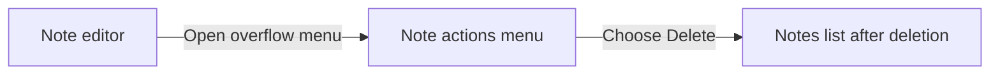
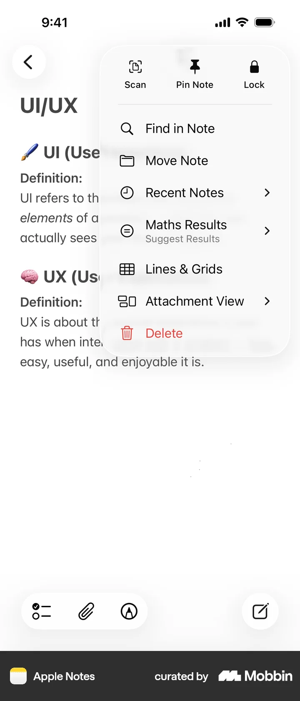

# Deleting a note

- Source: [Mobbin detail flow](https://mobbin.com/flows/1987c666-66ec-4101-b98f-f6c9500d9b99)
- App: Apple Notes iOS
- Device: iOS 393×852
- Screen count: 3
- Capture status: verified

## Flow chart

## Screens

### 1. Note actions menu

The note editor's overflow menu is open. It includes Scan, Pin Note, Lock, Find in Note, Move Note, Recent Notes, Maths Results, Lines & Grids, Attachment View, and a red `Delete` action.

### 2. Note editor after menu dismissal

The menu is closed and the note editor is visible again with the bottom checklist, attachment, and markup toolbar.

### 3. Notes list after deletion

The Notes list is visible with the remaining notes grouped under `Today` and `Previous 7 Days`. The deleted note is no longer present in the displayed list.

## BMad handoff notes

- Entry state: a note is open in the editor.
- Primary interaction: open the overflow menu and select the destructive `Delete` action.
- Expected result: the app returns to the Notes list and removes the deleted note from the visible list.
- Destructive behavior: deletion should be handled as a recoverable Notes operation if the product exposes Recently Deleted.
