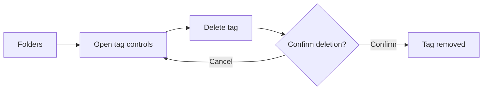
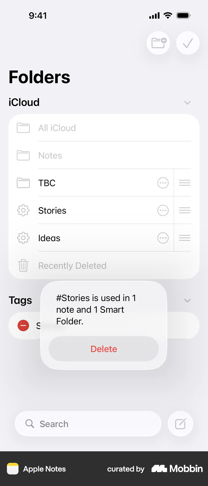
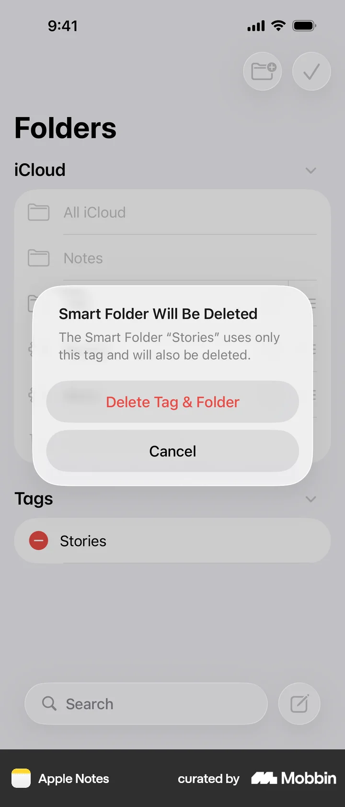

# Deleting a tag from Folders

- Source: [Mobbin flow](https://mobbin.com/flows/00973aef-3c12-49e9-9e96-a8e8b3aa690c)
- App: Apple Notes iOS
- Entry surface: Folders
- Screen count: 5
- Capture status: captured

## Flow chart

## Screens

### 1. Folders

### 2. Tag controls

### 3. Delete action

### 4. Confirmation state

### 5. Result

## Observations

- Deletion is a destructive action with a confirmation branch.
- Cancel returns to the tag context without changing the list.
- Confirm ends in a visibly updated Folders state.
