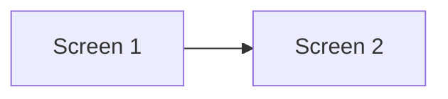
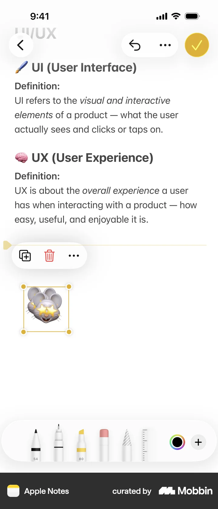

# Duplicating a sticker

- App: Apple Notes iOS
- Capture status: verified
- Source: [Mobbin detail flow](https://mobbin.com/flows/f5d2199f-39c6-4182-b256-0708db73448f)
- Verified screens: 2

## Flow chart

## Verified evidence

The screenshots below are downloaded from the Mobbin detail page for this exact flow.

### Screen 1

### Screen 2

## BMad handoff notes

- Implement the interaction sequence in the Mermaid order.
- Treat each screenshot as the visual reference for its corresponding state.
