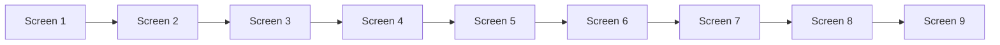
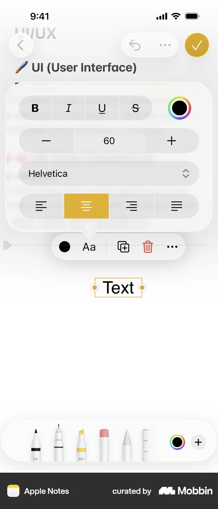
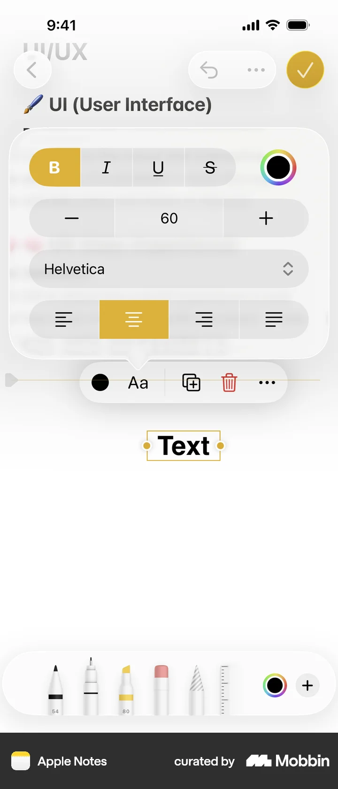
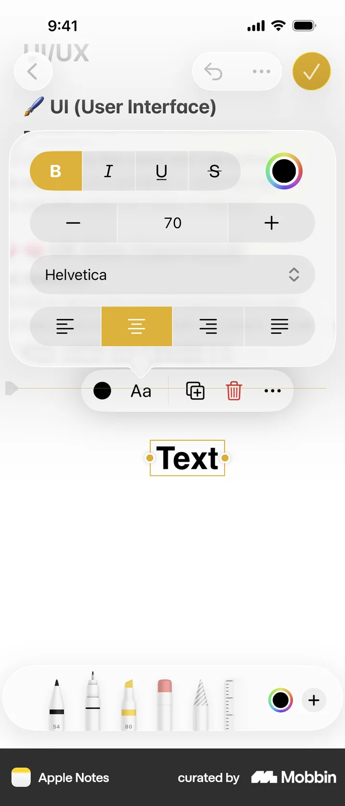
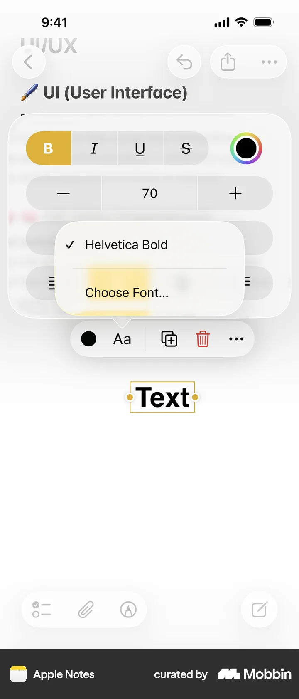
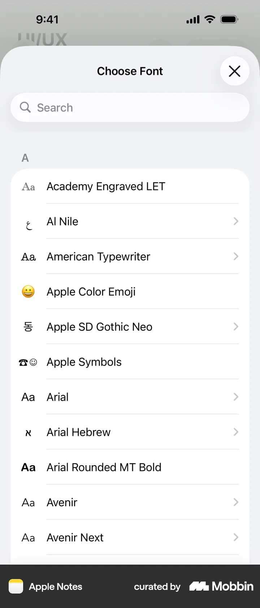
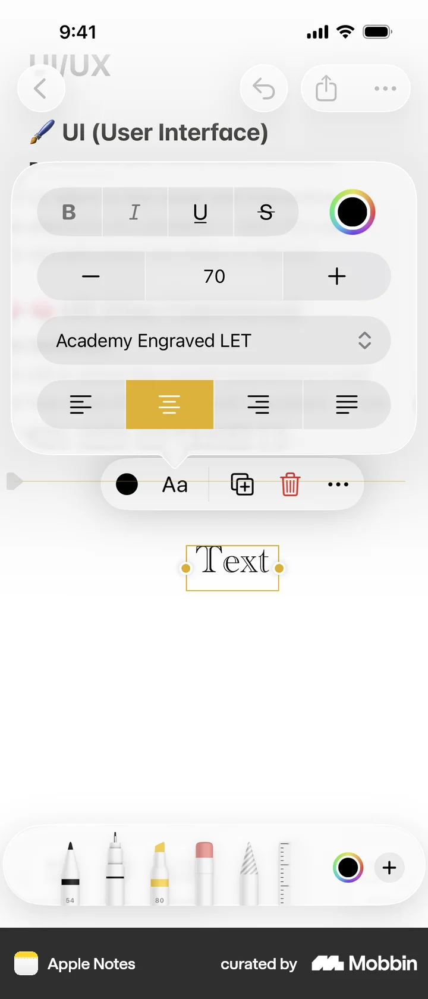
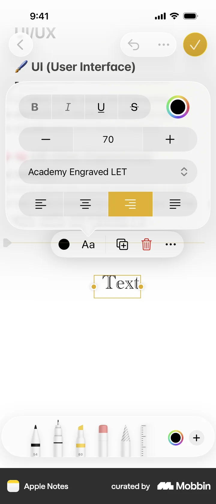
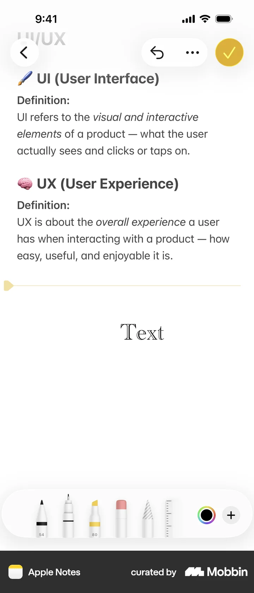

# Editing text

- App: Apple Notes iOS
- Capture status: verified
- Source: [Mobbin detail flow](https://mobbin.com/flows/dd8dbba3-c03f-4ed7-84e8-d9c11d31f69b)
- Verified screens: 9

## Flow chart

## Verified evidence

### Screen 1

### Screen 2

### Screen 3

### Screen 4

### Screen 5

### Screen 6

### Screen 7

### Screen 8

### Screen 9

## BMad handoff notes

- Implement the interaction sequence in Mermaid order.
- Treat each screenshot as the visual reference for its state.
