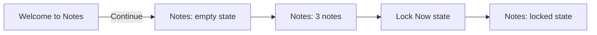
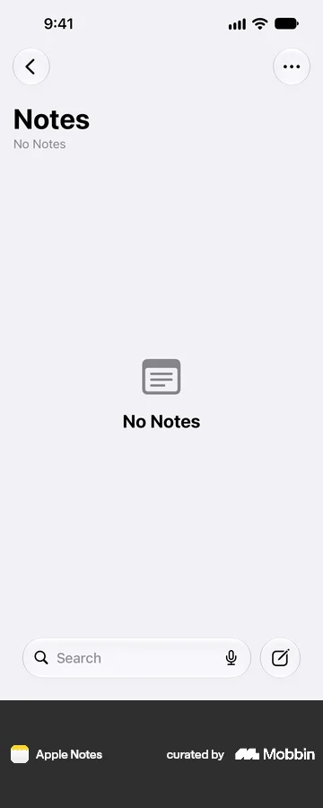
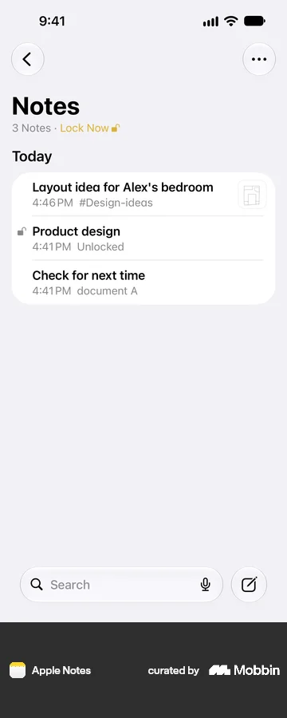
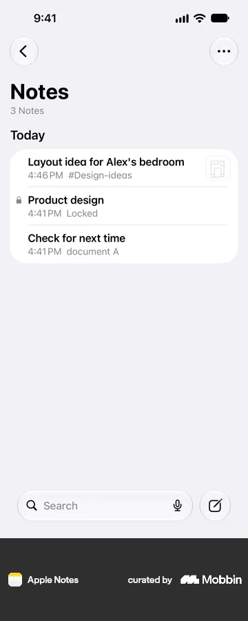

# Notes on Apple Notes

- Source: [Mobbin flow](https://mobbin.com/flows/f506ae89-db5a-46f1-952b-2a6d6c7d7649)
- App: Apple Notes iOS
- Device: iOS 393×852
- Screen count: 5
- Capture status: captured

## Flow chart

## Screens

### 1. Welcome to Notes

The onboarding screen introduces the Notes capabilities and requires `Continue` before entering the notes list.

### 2. Notes — empty state

The list has no notes yet. The screen exposes search and compose actions at the bottom.

### 3. Notes — populated state

The list contains three notes grouped under `Today`.

### 4. Notes — Lock Now state

The list shows the `Lock Now` action and a note marked `Unlocked`.

### 5. Notes — locked state

The same note is marked `Locked`, confirming the state change in the list.

## BMad handoff notes

- Experience: onboarding completion precedes the notes list; the empty state still exposes search and compose entry points.
- Experience: locking changes the list state in place and exposes the lock status next to the note.
- Design: preserve the strong hierarchy of the `Notes` title, date grouping, note rows, and bottom actions.
- Open question: define the exact trigger that changes the list from `Unlocked` to `Locked` in the clone.
