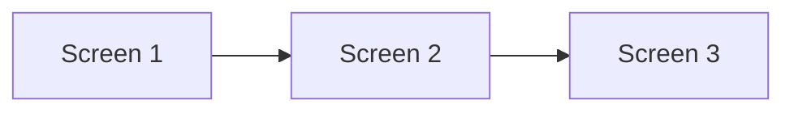
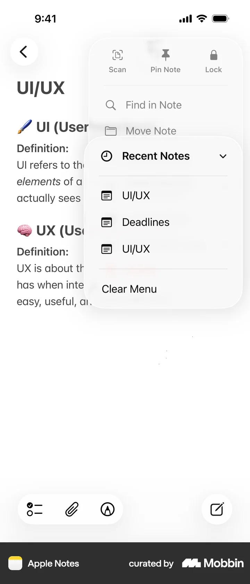
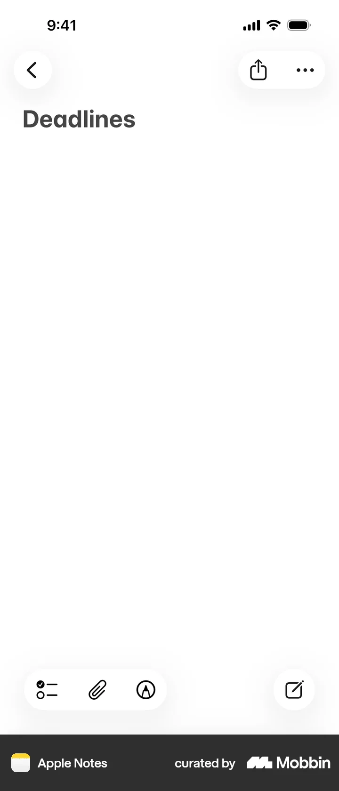

# Opening a recent note

- App: Apple Notes iOS
- Capture status: verified
- Source: [Mobbin detail flow](https://mobbin.com/flows/202f37ab-e3b4-4351-955f-e6a1f4bce6b8)
- Verified screens: 3

## Flow chart

## Verified evidence

### Screen 1

### Screen 2

### Screen 3

## BMad handoff notes

- Implement the interaction sequence in Mermaid order.
- Treat each screenshot as the visual reference for its state.
