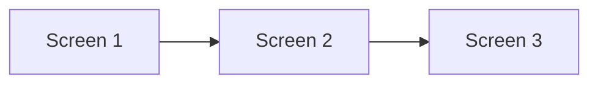
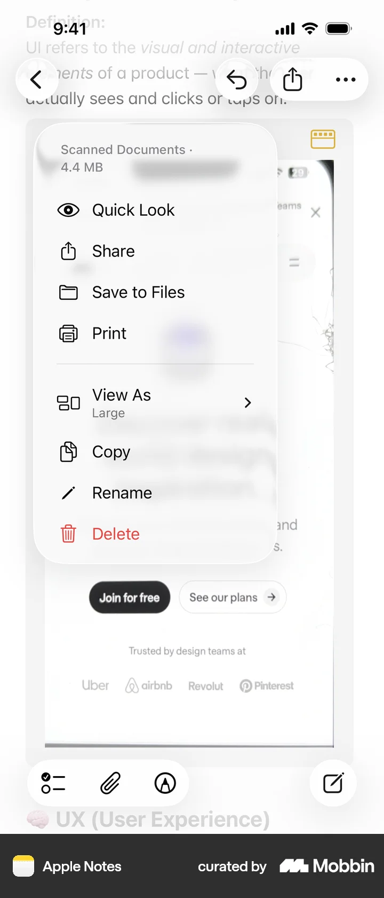

# Quick look

- App: Apple Notes iOS
- Capture status: verified
- Source: [Mobbin detail flow](https://mobbin.com/flows/22a448fc-fb46-47d5-b1d9-b0c39d233a0d)
- Verified screens: 3

## Flow chart

## Verified evidence

### Screen 1

### Screen 2

### Screen 3

## BMad handoff notes

- Implement the interaction sequence in Mermaid order.
- Treat each screenshot as the visual reference for its state.
