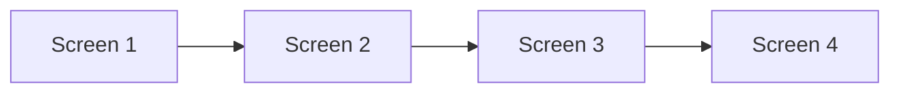
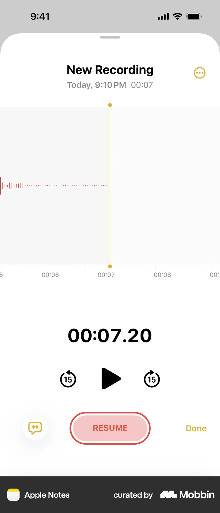
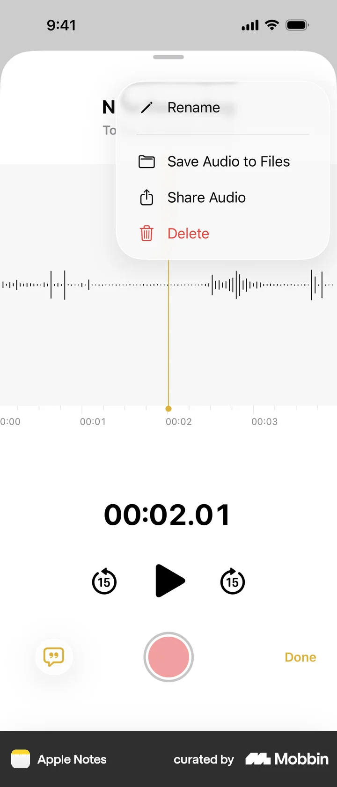
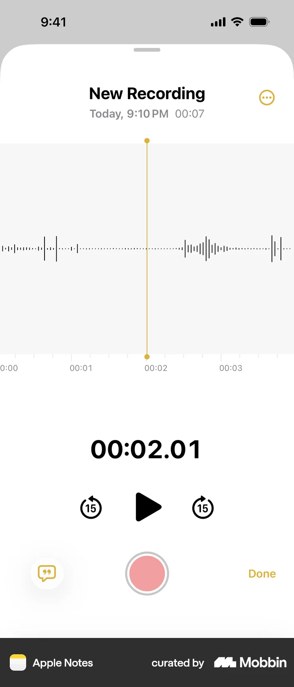
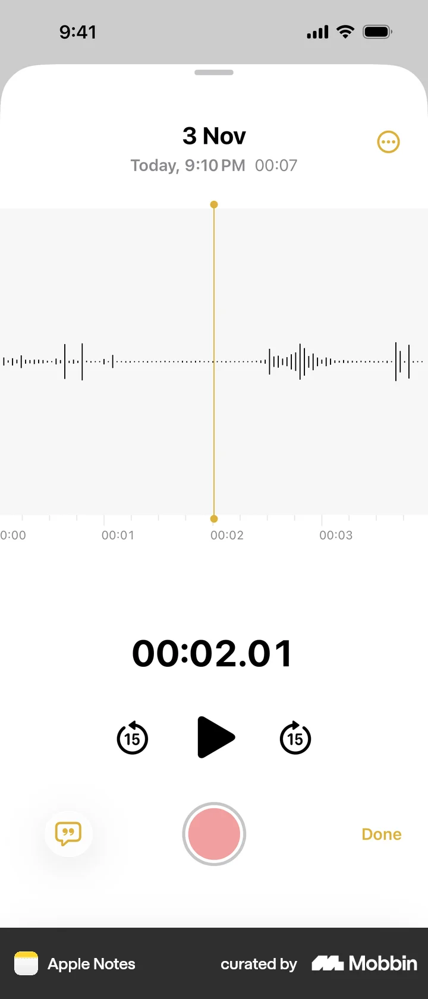

# Renaming a recording

- App: Apple Notes iOS
- Capture status: verified
- Source: [Mobbin detail flow](https://mobbin.com/flows/c8d8447c-b14c-4202-97f6-b3770a851e04)
- Verified screens: 4

## Flow chart

## Verified evidence

### Screen 1

### Screen 2

### Screen 3

### Screen 4

## BMad handoff notes

- Implement the interaction sequence in Mermaid order.
- Treat each screenshot as the visual reference for its state.
