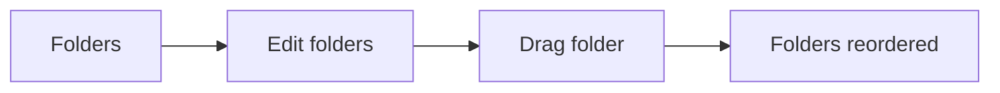
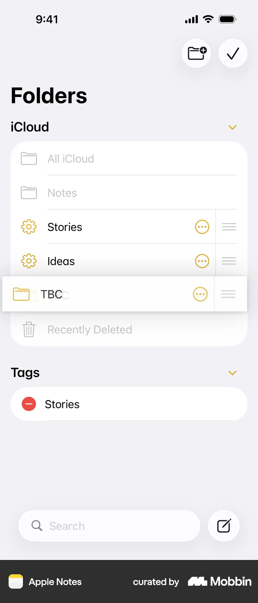
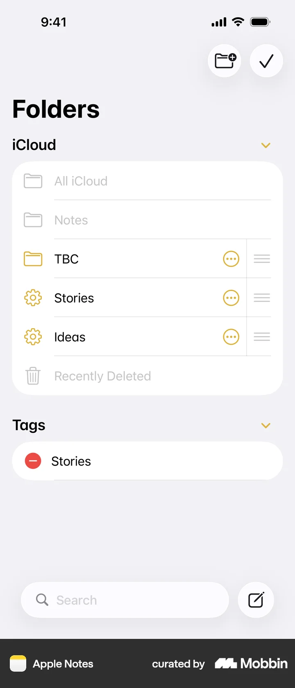
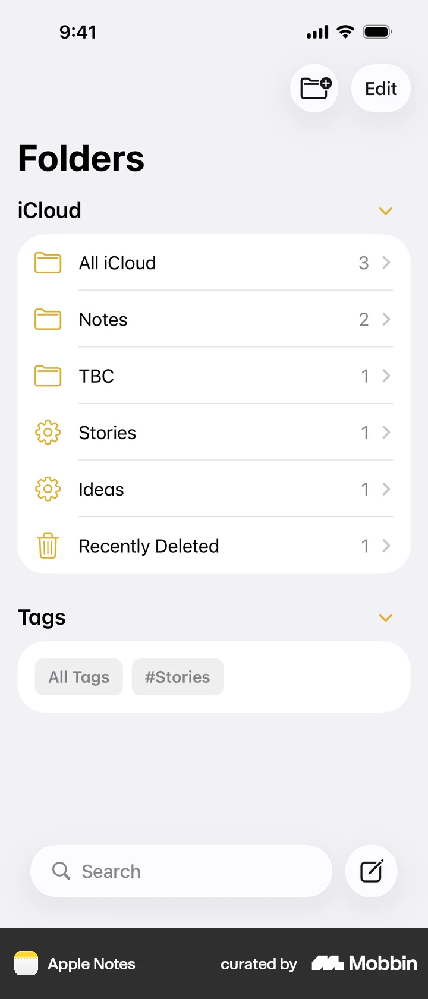

# Reordering folders from Folders

- Source: [Mobbin flow](https://mobbin.com/flows/e929a163-5ebc-465f-98af-165689d5ecad)
- App: Apple Notes iOS
- Entry surface: Folders
- Screen count: 4
- Capture status: captured

## Flow chart

## Screens

### 1. Folders

### 2. Edit folders

### 3. Drag folder

### 4. Reordered result

## Observations

- The flow starts from the Folders surface.
- Reordering is a direct manipulation gesture with a visible positional result.
- The final state remains inspectable after the gesture completes.
