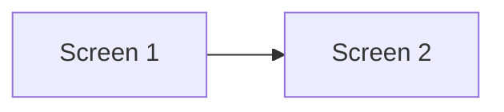
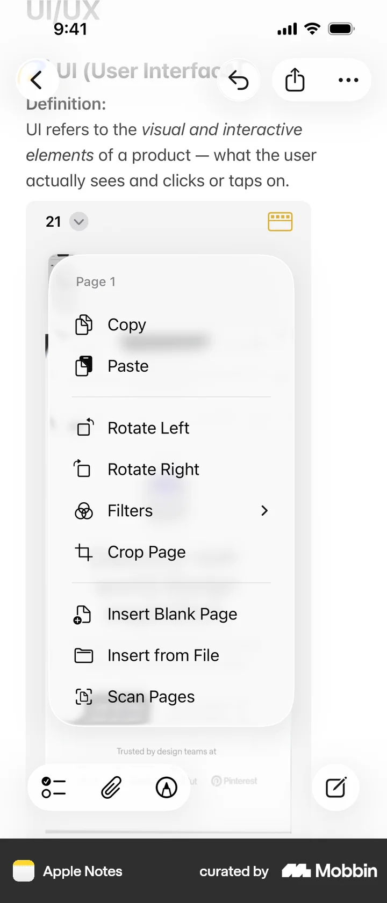
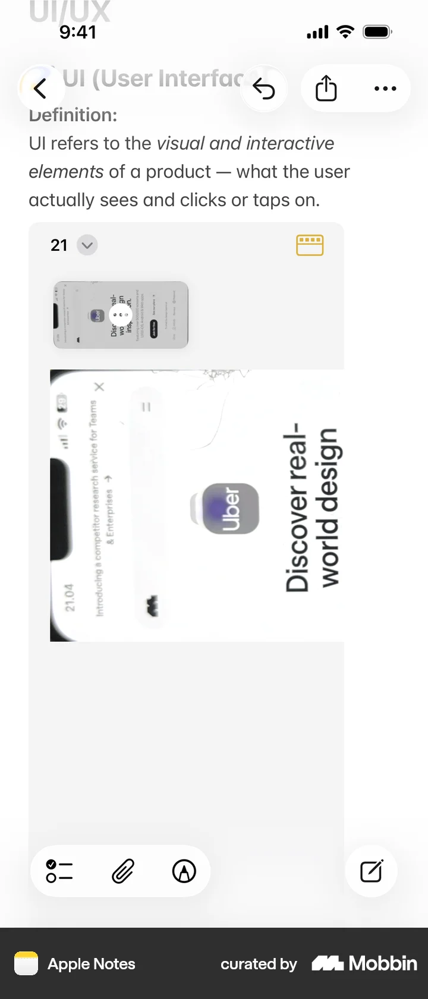

# Rotating a page

- App: Apple Notes iOS
- Capture status: verified
- Source: [Mobbin detail flow](https://mobbin.com/flows/4c798cb7-7ed5-4e7d-8c0b-1f1efd6cfe2a)
- Verified screens: 2

## Flow chart

## Verified evidence

### Screen 1

### Screen 2

## BMad handoff notes

- Implement the interaction sequence in Mermaid order.
- Treat each screenshot as the visual reference for its state.
