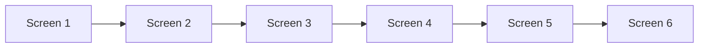
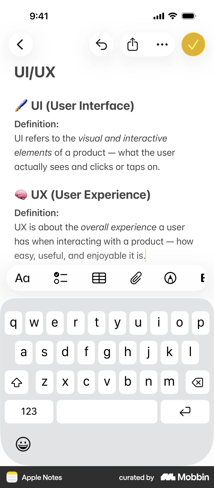
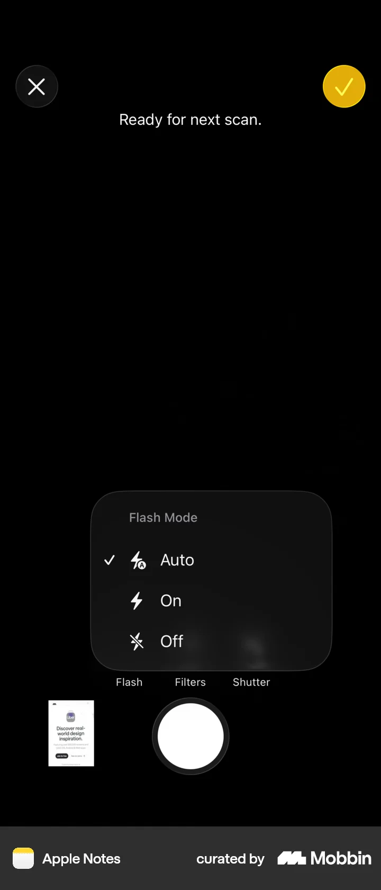
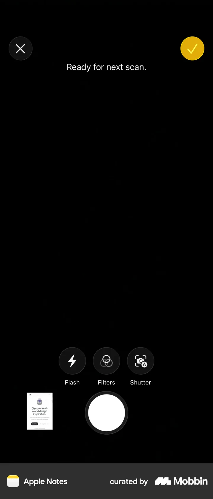
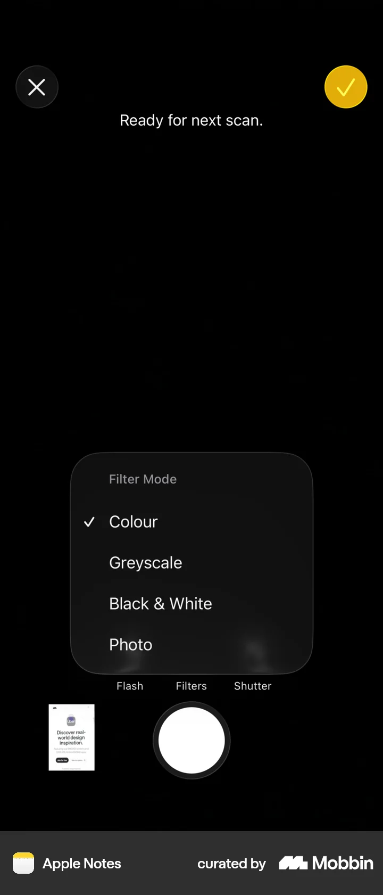
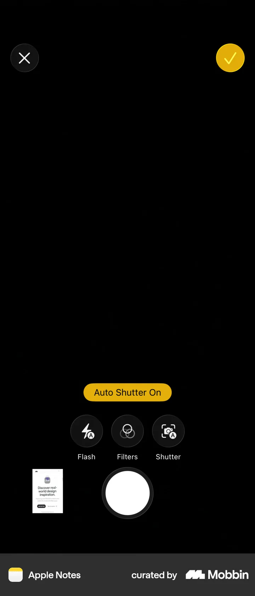

# Setting up camera

- App: Apple Notes iOS
- Capture status: verified
- Source: [Mobbin detail flow](https://mobbin.com/flows/6ae5caf4-2499-4946-8296-a3bd65131fcc)
- Verified screens: 6

## Flow chart

## Verified evidence

### Screen 1

### Screen 2

### Screen 3

### Screen 4

### Screen 5

### Screen 6

## BMad handoff notes

- Implement the interaction sequence in Mermaid order.
- Treat each screenshot as the visual reference for its state.
