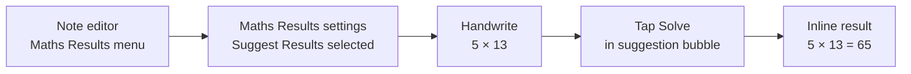

# Solving a math equation

- App: Apple Notes iOS
- Capture status: verified
- Source: [Mobbin detail flow](https://mobbin.com/flows/524f75d7-141e-46d0-922b-a843f08c24ea)
- Verified screens: 5

## Flow chart

## Observed sequence

| # | Observed state | Evidence |
|---:|---|---|
| 1 | In the note editor, the overflow menu exposes **Maths Results** and **Suggest Results**. |  |
| 2 | The Maths Results submenu is open; **Suggest Results** is selected and **Insert Results** / **Off** are available. |  |
| 3 | The user writes the handwritten expression `5 × 13` while the drawing toolbar is visible. |  |
| 4 | Notes recognizes the expression and shows a result bubble with **Solve**. |  |
| 5 | The solved value is rendered inline as `5 × 13 = 65`. |  |

## BMad handoff notes

- Preconditions: a note is open in edit mode; Maths Results is set to **Suggest Results**.
- Primary interaction: handwrite a mathematical expression, then select **Solve** from the recognition bubble.
- Expected result: the expression remains in the note and the evaluated result is inserted inline.
- Reversible state: the Maths Results setting can be changed to **Insert Results** or **Off** from the same submenu.

