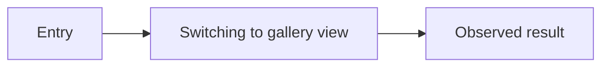
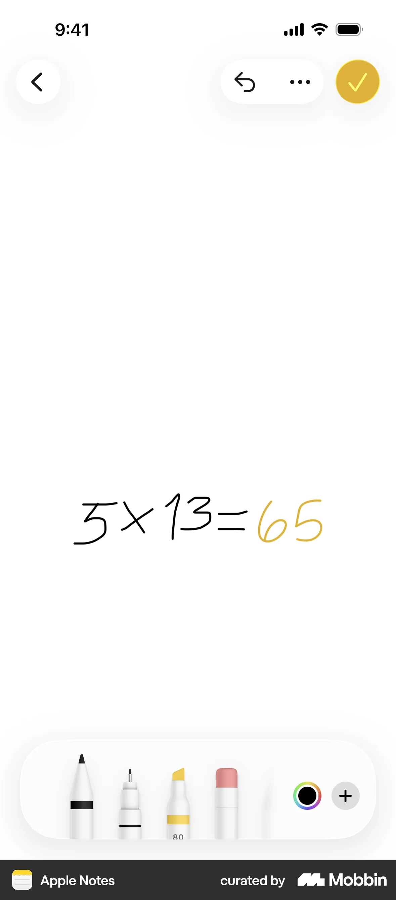

# Switching to gallery view

- App: Apple Notes iOS
- Capture status: captured
- Source: [Mobbin Apple Notes flows](https://mobbin.com/apps/apple-notes-ios-201a63f1-7499-4ebe-b92d-401605aa41bb/1782dd26-1259-4ebf-b402-384a81685971/flows)

## Flow chart

## Reference screen

## BMad handoff notes

- Record the observed entry point, action, result, and any destructive or reversible state here.
- Promote confirmed behavior into `EXPERIENCE.md`; promote visual decisions into `DESIGN.md`.
